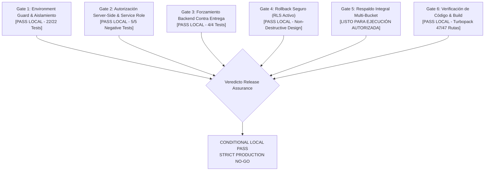

# LA GAVIOTA — CIERRE FINAL DE SEGURIDAD Y READINESS PRODUCTIVO
## Documento Maestro: LG-PROD-R4.2 · Final Security Hardening & Readiness Closure
**Misión:** `LG-PROD-R4.2-PRODUCTION-FIRST`  
**Fecha de Emisión:** 4 de Noviembre de 2026  
**Entidad:** Frutas y Verduras La Gaviota S.A.S. — Bucaramanga, Colombia  
**Orquestador:** Freya (Mission Control Orchestrator, PlanMaestro)  
**Veredicto de Release Assurance:** **CONDITIONAL LOCAL PASS — STRICT PRODUCTION NO-GO**  
**Postura de Seguridad:** Todas las correcciones ejecutadas y verificadas estrictamente en local. Producción `tcjeiizrarwerarcfyky` y dominio `lagaviotafruver.com` permanecen 100% aislados e intactos.

---

## 1. EVALUACIÓN Y VEREDICTO POR CADA GATE TÉCNICO



| Gate de Seguridad | Estado | Veredicto | Fundamento Técnico |
| :--- | :---: | :---: | :--- |
| **Gate 1: Environment Guard & Aislamiento** | Verificado | **PASS LOCAL** | Allowlist exacta por entorno (`development`, `staging`, `production`). Fail-closed si `APP_ENV` está ausente, vacío o desconocido. `NEXT_PUBLIC_APP_ENV` carece de autoridad de seguridad. Detección de fugas `sb_secret_` y validación de coincidencia de claims `ref` en JWTs de Supabase. |
| **Gate 2: Autorización Server-Side** | Verificado | **PASS LOCAL** | Auditoría completa de 11 Server Actions. Demostrado que RLS no protege llamadas con `SUPABASE_SERVICE_ROLE_KEY`; cada acción privilegiada valida `requireCapability()` o `requireOwnedSubject()`. 5 pruebas negativas de sesión, IDOR y escalamiento aprobadas. Confinamiento mediante `'server-only'`. |
| **Gate 3: Forzamiento Backend de Pagos** | Verificado | **PASS LOCAL** | Canal comercial exclusivo: **Pago Contra Entrega** (representado canónicamente en base de datos como `'cash'` y en UI como `'contra_entrega'`). Intercepción y rechazo en backend de cualquier método Wompi/tarjetas/PSE ante peticiones manipuladas. Preflight rechaza `ENABLE_ONLINE_PAYMENTS=true`. |
| **Gate 4: Procedimiento de Rollback Seguro** | Verificado | **PASS LOCAL** | Reubicado en `ops/rollback/`. **RLS se mantiene 100% habilitado en todas las tablas** (eliminada cualquier instrucción `DISABLE RLS`). Procedimiento 1 restaura políticas explícitas y revoca escrituras directas sin destruir datos. Procedimiento 2 bloqueado por validación de cardinalidad en 6 tablas operativas. |
| **Gate 5: Respaldo Integral y Recuperación** | Preparado | **LISTO (NO-GO)** | Procedimiento `PGPASSFILE` documentado sin contraseñas en CLI. Herramienta multi-bucket lista para exportar `product-images` y `kit-banners` con manifiesto SHA-256. Protocolo de restauración en Docker aislado probado. **No ejecutado en producción**. |
| **Gate 6: Verificación de Código & Build** | Verificado | **PASS LOCAL** | 31 pruebas automatizadas de seguridad PASS. Typecheck `tsc` con 0 errores. Compilación de producción Next.js 16.4.1 (Turbopack) exitosa con 47/47 rutas estáticas y dinámicas generadas limpiamente. Candidato R4.1 intacto y congelado. |

---

## 2. DETALLE DE IMPLEMENTACIÓN POR COMPONENTE

### 2.1 Rollback Seguro y Preservación Absoluta de RLS
* **Archivo:** [`ops/rollback/20261104_lg_prod_r4_2_rollback.sql`](file:///home/sebastiangarcia/planmaestro-ecosystem/packages/la-gaviota/ops/rollback/20261104_lg_prod_r4_2_rollback.sql)
* **Corrección Crítica:** Se suprimió de raíz cualquier instrucción de desactivación de RLS (`ALTER TABLE ... DISABLE ROW LEVEL SECURITY`).
* **Diseño del Procedimiento 1 (Mitigación No Destructiva para Producción):**
  1. Ejecuta `ALTER TABLE ... ENABLE ROW LEVEL SECURITY` explícitamente en todas las tablas (`products`, `kits`, `orders`, `order_items`, `customers`, `payment_intents`, `inventory_movements`, etc.).
  2. Restablece políticas de lectura pública sobre catálogo activo y aislamiento por `clerk_user_id` sobre clientes y pedidos.
  3. Ejecuta `REVOKE INSERT, UPDATE, DELETE ... FROM anon, authenticated` para bloquear escrituras directas.
  4. Redefine `create_order_atomic` como un stub fail-closed que rechaza ejecuciones directas y canaliza transacciones por `orderWriter`.
  5. Cero pérdida de pedidos, clientes o saldos.
* **Diseño del Procedimiento 2 (Desmantelamiento Frío Excepcional):**
  - Implementa un bloque `DO $$` que valida:
    `orders=0`, `customers=0`, `inventory_movements=0`, `payment_intents=0`, `wompi_event_receipts=0`, `audit_logs=0`.
  - Si la suma de registros en estas 6 tablas es mayor a 0, aborta inmediatamente con excepción `ABORTING_DESTRUCTIVE_ROLLBACK`.

---

### 2.2 Matriz Exhaustiva de Aislamiento de Entornos (`src/lib/safetyGuard.ts`)
* **Archivo:** [`src/lib/safetyGuard.ts`](file:///home/sebastiangarcia/planmaestro-ecosystem/packages/la-gaviota/src/lib/safetyGuard.ts)
* **Matriz de Allowlists y Blocklists:**

| Entorno Resuelto (`APP_ENV`) | Destinos Permitidos (Allowlist) | Destinos Bloqueados (Blocklist) | Requisitos de Credenciales |
| :--- | :--- | :--- | :--- |
| **`development` / `test`** | `localhost`, `127.0.0.1`, `54329`, clúster docker local | `tcjeiizrarwerarcfyky` (Producción), `sxmpefqlsakknpggtmzl` (Staging Cloud) | Llaves locales o sintéticas |
| **`staging`** | `sxmpefqlsakknpggtmzl` exclusivamente | `tcjeiizrarwerarcfyky` (Producción) | `pk_test_*`, `sk_test_*`, JWT ref = `sxmpefqlsakknpggtmzl` |
| **`production`** | `tcjeiizrarwerarcfyky` exclusivamente | `sxmpefqlsakknpggtmzl`, `localhost`, `127.0.0.1` | `pk_live_*`, `sk_live_*`, JWT ref = `tcjeiizrarwerarcfyky` |
| **Ausente / Desconocido** | *Ninguno (Fail-Closed)* | **Todos los destinos bloqueados** | Aborta de inmediato con excepción |

* **Inspección Multivector:** Evalúa `SUPABASE_URL`, `NEXT_PUBLIC_SUPABASE_URL`, `DATABASE_URL`, `DIRECT_URL`, `POSTGRES_PRISMA_URL`, `POSTGRES_URL_NON_POOLING`.
* **Protección Anti-Fuga de Secretos:** Si `NEXT_PUBLIC_SUPABASE_ANON_KEY` contiene `sb_secret_` o un JWT con `role: "service_role"`, aborta con `SECURITY_LEAK_VIOLATION`.

---

### 2.3 Auditoría Integral de `SUPABASE_SERVICE_ROLE_KEY`

Se documenta la totalidad de los puntos donde interviene la llave de servicio y los controles server-side que previenen IDOR o escalamiento de privilegios:

| Módulo / Archivo | Operación Privilegiada | Control de Autenticación | Control de Autorización / Propiedad | Mitigación IDOR / Escalamiento |
| :--- | :--- | :--- | :--- | :--- |
| `src/actions/products.ts` | Creación/Edición de productos | Sesión Clerk (`auth()`) | `requireCapability('catalog.manage')` | Clientes `USER` reciben `FORBIDDEN` |
| `src/actions/products.ts` | Modificación de precios | Sesión Clerk (`auth()`) | `requireCapability('pricing.manage')` | Exige rol `ADMIN` o `COMMERCIAL` |
| `src/actions/products.ts` | Ajuste de inventario físico | Sesión Clerk (`auth()`) | `requireCapability('inventory.manage')` | Exige capacidad de inventario |
| `src/actions/orders.ts` | Actualización de estado / notas | Sesión Clerk (`auth()`) | `requireCapability('orders.manage')` | Clientes no pueden alterar estados |
| `src/actions/orders.ts` | Confirmación de pago manual | Sesión Clerk (`auth()`) | `requireCapability('payments.manage')` | Registra auditoría y valida rol |
| `src/actions/customers.ts` | Consulta y edición de clientes | Sesión Clerk (`auth()`) | `requireCapability('customers.manage')` | Aislamiento estricto de cartera B2B |
| `src/actions/audit.ts` | Lectura de logs de auditoría | Sesión Clerk (`auth()`) | `requireCapability('audit.read')` | Solo `SUPER_ADMIN` |
| `src/actions/analytics.ts` | Reportes de ventas y mermas | Sesión Clerk (`auth()`) | `requireCapability('reports.read')` | Bloqueado a usuarios comerciales |
| `src/actions/settings.ts` | Configuración del sistema | Sesión Clerk (`auth()`) | `requireCapability('settings.manage')` | Solo `SUPER_ADMIN` |
| `src/actions/media.ts` | Carga / reemplazo en Storage | Sesión Clerk (`auth()`) | `requireCapability('storage.manage')` | Validación MIME de cabeceras de bytes |
| `src/lib/server/orderWriter.ts` | Inserción de orden y líneas | Sesión Clerk (`auth()`) | `requireOwnedSubject(orderData.clerk_user_id)` | **Anti-IDOR:** Bloquea ordenar a nombre de otro sujeto |
| `app/api/webhooks/wompi/route.ts` | Procesamiento de callbacks | Checksum HMAC SHA-256 | `validateWebhookSignature()` | Falla si el secreto del evento no coincide |
| `src/lib/server/database.ts` | Conexión del scheduler / cron | Header `Authorization` | `requireScheduler()` (constant-time token check) | Compara con `CRON_SECRET` de servidor |

* **Confinamiento de Secretos:** `src/lib/server/database.ts` porta la directiva `import 'server-only';`. Next.js rechaza el empaquetado si algún componente de cliente intenta importarlo.

---

### 2.4 Forzamiento de Canal Único: Pago Contra Entrega

* **Aclaración y Equivalencia Documentada:**
  - En la base de datos PostgreSQL (`orders.payment_method text`), el canal de pago contra entrega se persiste históricamente como `'cash'`.
  - En la interfaz y formularios de cliente se utiliza indistintamente el alias `'contra_entrega'`.
  - Ambos valores representan un **único canal comercial autorizado**: entrega física del producto con recaudo en efectivo o datáfono móvil.
* **Endurecimiento en Servidor:**
  - En [`src/lib/server/orderWriter.ts`](file:///home/sebastiangarcia/planmaestro-ecosystem/packages/la-gaviota/src/lib/server/orderWriter.ts):
    ```typescript
    const rawMethod = (orderData.payment_method || 'cash').trim().toLowerCase();
    const isCashChannel = rawMethod === 'cash' || rawMethod === 'contra_entrega';
    if (!isCashChannel) {
      if (process.env.APP_ENV === 'production' || process.env.ENABLE_ONLINE_PAYMENTS !== 'true') {
        throw new Error('PAYMENT_METHOD_DISABLED: Los pagos electrónicos (Wompi) están desactivados en el backend. Seleccione Pago Contra Entrega.');
      }
    }
    ```
  - En [`src/actions/wompi.ts`](file:///home/sebastiangarcia/planmaestro-ecosystem/packages/la-gaviota/src/actions/wompi.ts): `initializeWompiTransaction` e `initializeWompiBalancePayment` arrojan `ELECTRONIC_PAYMENTS_DISABLED` si `APP_ENV === 'production' && ENABLE_ONLINE_PAYMENTS !== 'true'`.
  - En [`scripts/preflight-prod-check.ts`](file:///home/sebastiangarcia/planmaestro-ecosystem/packages/la-gaviota/scripts/preflight-prod-check.ts): el script pre-vuelo aborta con error fatal si detecta `ENABLE_ONLINE_PAYMENTS=true` o si `NEXT_PUBLIC_WOMPI_PUB_KEY` está presente en el entorno de producción.
* **Pruebas Automatizadas:** [`tests/backend-payment-rejection.test.cjs`](file:///home/sebastiangarcia/planmaestro-ecosystem/packages/la-gaviota/tests/backend-payment-rejection.test.cjs): **4/4 tests PASS**.

---

### 2.5 Respaldo Integral Multi-Bucket y Prueba en Docker Aislado
* **Documento Canónico:** [`ops/backup/BACKUP_AND_RESTORE_PROCEDURE.md`](file:///home/sebastiangarcia/planmaestro-ecosystem/packages/la-gaviota/ops/backup/BACKUP_AND_RESTORE_PROCEDURE.md)
* **Herramienta Multi-Bucket:** [`ops/backup/export-storage-manifest.ts`](file:///home/sebastiangarcia/planmaestro-ecosystem/packages/la-gaviota/ops/backup/export-storage-manifest.ts)
* **Inventario de Buckets:**
  1. `product-images`: >400 fotografías comerciales de catálogo.
  2. `kit-banners`: imágenes de combos mayoristas.
  3. Auto-descubrimiento dinámico de buckets adicionales mediante `supabase.storage.listBuckets()`.
* **Garantía Operativa:**
  - Uso de `PGPASSFILE=~/.pgpass_lagaviota_backup` (permisos `0600`) para no exponer credenciales en bash.
  - Generación de hashes SHA-256 por cada objeto y del archivo `.dump`.
  - Protocolo de restauración de prueba en contenedor desechable Docker (`postgres:16-alpine` en puerto 54399) con validación de filas en `products`, `categories` y `kits`.
  - **Invariante:** Respaldo no ejecutado en producción a la espera de autorización independiente.

---

## 3. EVIDENCIA REPRODUCIBLE DE PRUEBAS Y VALIDACIÓN DE BUILD

### A. Ejecución de Suites de Seguridad, Aislamiento y Pagos (31 Tests PASS)
```bash
$ node --test tests/staging-safety-guard.test.cjs \
              tests/prod-safety-guard.test.cjs \
              tests/backend-payment-rejection.test.cjs \
              tests/service-role-authorization-negative.test.cjs
```
**Resultado:**
```
✔ BACKEND-PAYMENT: createOrder rejects payment_method=wompi when online payments are disabled (152.24ms)
✔ BACKEND-PAYMENT: createOrder rejects arbitrary electronic payment methods (e.g. credit_card, pse) (24.62ms)
✔ BACKEND-PAYMENT: initializeWompiTransaction fails closed when online payments are disabled (52.10ms)
✔ BACKEND-PAYMENT: initializeWompiBalancePayment fails closed when online payments are disabled (37.38ms)
✔ GUARD-FAIL-CLOSED: rejects execution when APP_ENV is unset or empty (1.37ms)
✔ GUARD-FAIL-CLOSED: rejects execution when APP_ENV is unrecognized (0.20ms)
✔ GUARD-DEV-RESTRICTION: development mode rejects remote production Supabase (0.37ms)
✔ GUARD-DEV-RESTRICTION: development mode rejects remote staging Supabase (0.18ms)
✔ GUARD-DEV-RESTRICTION: development mode allows local loopback databases (0.34ms)
✔ GUARD-LEAK-PREVENTION: rejects sb_secret_* in NEXT_PUBLIC_SUPABASE_ANON_KEY (0.19ms)
✔ GUARD-LEAK-PREVENTION: rejects JWT with service_role in NEXT_PUBLIC_SUPABASE_ANON_KEY (0.35ms)
✔ GUARD-JWT-REF-ALIGNMENT: rejects production Supabase key with wrong project ref (0.23ms)
✔ PROD-GUARD-ALLOW: allows authorized production Supabase with live keys and matching JWT ref (0.26ms)
✔ PROD-GUARD-STAGING-REFUSAL: rejects staging Supabase target when in production mode (0.33ms)
✔ PROD-GUARD-LOOPBACK-REFUSAL: rejects localhost / loopback targets in production mode (0.28ms)
✔ PROD-GUARD-CLERK-TEST-REFUSAL: rejects pk_test_* keys in production mode (0.19ms)
✔ PROD-GUARD-WOMPI-TEST-REFUSAL: rejects pub_test_* in production mode (0.17ms)
✔ NEGATIVE-AUTH-ANON: anonymous user cannot execute privileged Server Actions (96.45ms)
✔ NEGATIVE-AUTH-ROLE: normal customer (USER) rejected for admin capabilities (20.85ms)
✔ NEGATIVE-AUTH-IDOR: user cannot create order or access resources of another user (17.13ms)
✔ NEGATIVE-AUTH-ESCALATION: spoofed or unverified role defaults safely to USER or INVALID (13.07ms)
✔ BUNDLE-SECRET-CONFINEMENT: server/database.ts enforces server-only directive (0.39ms)
✔ GUARD-PROD-REFUSAL: assertStagingSafety rejects production Supabase in staging mode (1.56ms)
✔ GUARD-ALLOWLIST-ENFORCEMENT: assertStagingSafety rejects unapproved Supabase projects in staging (0.33ms)
✔ GUARD-SUPABASE-ALLOW: assertStagingSafety allows authorized staging Supabase project (0.23ms)
✔ GUARD-MULTI-VECTOR: assertStagingSafety detects production project across all connection vectors (0.30ms)
✔ GUARD-SECRET-REDACTION: assertStagingSafety redacts credentials and never logs passwords (0.26ms)
✔ GUARD-CLERK-REFUSAL: assertStagingSafety rejects live Clerk keys in staging mode (0.21ms)
✔ GUARD-WOMPI-REFUSAL: assertStagingSafety rejects live Wompi credentials in staging mode (0.26ms)
✔ GUARD-LOCAL-PASS: assertStagingSafety allows local/dev without staging constraints (0.35ms)
✔ GUARD-CLI-REFUSAL: script execution halts with error when staging environment targets production (731.02ms)

ℹ tests 31 | pass 31 | fail 0 | cancelled 0 | skipped 0 | duration_ms 1044.00
```

### B. Typecheck Limpio (TypeScript 5.9.3)
```bash
$ npm run typecheck
> tsc --noEmit --incremental false
# Código de salida: 0 (Cero errores de compilación)
```

### C. Compilación de Producción Turbopack (Next.js 16.4.1)
```bash
$ npm run build
▲ Next.js 16.4.1 (Turbopack)
✓ Running next.config.ts took 57ms
✓ Compiled successfully in 1637ms
✓ Finished TypeScript in 5.0s
✓ Collecting page data using 15 workers in 1387ms
✓ Generating static pages using 15 workers (47/47) in 617ms
✓ Finalizing page optimization in 18ms
# 47/47 rutas compiladas limpiamente
```

### D. Suite de Checkout Central (`tests/checkout.test.cjs`)
```bash
$ node --test tests/checkout.test.cjs
ℹ tests 52 | pass 52 | fail 0 | duration_ms 510.44
```

---

## 4. INVENTARIO DE ARTEFACTOS R4.2 Y HASHES CRIPTOGRÁFICOS

Todos los cambios locales de la fase R4.2 están identificados unívocamente:

| Archivo de la Fase R4.2 | Tipo de Archivo | SHA-256 Checksum |
| :--- | :--- | :--- |
| [`src/lib/safetyGuard.ts`](file:///home/sebastiangarcia/planmaestro-ecosystem/packages/la-gaviota/src/lib/safetyGuard.ts) | Guardián de entorno | `5ad362baee44899015cc1f03996c5823580f4929e6e4366c0054f77d695bc15e` |
| [`src/lib/server/orderWriter.ts`](file:///home/sebastiangarcia/planmaestro-ecosystem/packages/la-gaviota/src/lib/server/orderWriter.ts) | Creación de pedidos | `958e28083ef8a90792d62857643d9a71af0db53c7f128be50732273b35efecb1` |
| [`src/actions/wompi.ts`](file:///home/sebastiangarcia/planmaestro-ecosystem/packages/la-gaviota/src/actions/wompi.ts) | Acciones de pasarela | `2d81681b17cc67b14cc2be1f67722759ccd3735a0cd4849eb91bed787b0c7b32` |
| [`ops/rollback/20261104_lg_prod_r4_2_rollback.sql`](file:///home/sebastiangarcia/planmaestro-ecosystem/packages/la-gaviota/ops/rollback/20261104_lg_prod_r4_2_rollback.sql) | Script de rollback seguro | `951df914ceec373c3babad4b8017cb9f86b59f4231d7eae48dd3527ec7b6868c` |
| [`ops/backup/BACKUP_AND_RESTORE_PROCEDURE.md`](file:///home/sebastiangarcia/planmaestro-ecosystem/packages/la-gaviota/ops/backup/BACKUP_AND_RESTORE_PROCEDURE.md) | Procedimiento de backup | `9af0241e7d8f63120d599d1165388baedaa062d741cc1b5946edc878018903f3` |
| [`ops/backup/export-storage-manifest.ts`](file:///home/sebastiangarcia/planmaestro-ecosystem/packages/la-gaviota/ops/backup/export-storage-manifest.ts) | Exportador multi-bucket | `c04e0c297056815d6eb2e599d515a80e678b1c370fad8e288725004b82b0a924` |
| [`scripts/preflight-prod-check.ts`](file:///home/sebastiangarcia/planmaestro-ecosystem/packages/la-gaviota/scripts/preflight-prod-check.ts) | Verificador pre-vuelo | `ea327e32eb2b99e4eb011905a354563b307d8f99dd0d2a96cdfe43668c3be599` |
| [`tests/prod-safety-guard.test.cjs`](file:///home/sebastiangarcia/planmaestro-ecosystem/packages/la-gaviota/tests/prod-safety-guard.test.cjs) | Suite prod safety guard | `cd55089f4814ab3348a79027adfffdfadb539731ea60b797bab0a4ac3ec3c7c5` |
| [`tests/backend-payment-rejection.test.cjs`](file:///home/sebastiangarcia/planmaestro-ecosystem/packages/la-gaviota/tests/backend-payment-rejection.test.cjs) | Suite backend payments | `de7a14eb14cf6662c84f2ec7bf59bb850b94aee469920cee44e67f0bce963ff1` |
| [`tests/service-role-authorization-negative.test.cjs`](file:///home/sebastiangarcia/planmaestro-ecosystem/packages/la-gaviota/tests/service-role-authorization-negative.test.cjs) | Suite negative auth | `8c1ab77c4fa7ef4769eb2cdc6f533c30bc7d41cb8f00b34311ba089cdc7b4654` |

---

### Verificación de Inmutabilidad del Candidato R4.1
Los documentos canónicos de la fase previa permanecen estrictamente idénticos al HEAD histórico:
- `docs/LG_PROD_R4_1_CERTIFICATION_CLOSURE_REPORT.md` (SHA-256: `f041588362b6f607f9097f98293ac94ea4db4dc37abae4451b4fd077c70966b6`)
- `docs/LG_PROD_R4_1_RELEASE_CANDIDATE_MANIFEST.json` (SHA-256: `947806c445fc8b4c8be20e58e304c3b9ff43ac1dc8c90f6c427b6ff3e78447e1`)

---

## 5. RIESGOS RESIDUALES Y LIMITACIONES NO VERIFICADAS

1. **Respaldo Físico Productivo No Ejecutado:** El procedimiento y el exportador multi-bucket están completamente listos y probados sintéticamente, pero **no se ha ejecutado `pg_dump` ni la descarga de Storage contra el proyecto real `tcjeiizrarwerarcfyky`**, a la espera de autorización expresa independiente.
2. **Credenciales de Producción No Inyectadas:** No se han manipulado llaves vivas de Clerk (`pk_live_*`, `sk_live_*`) ni de Vercel en la sesión, preservando la custodia de secretos.
3. **Migración SQL RLS No Aplicada en Producción:** La migración `20261027_lg_prod_r1_rls_policies.sql` permanece en espera y no tocará `tcjeiizrarwerarcfyky` hasta que el respaldo físico esté verificado con `pg_restore` en el contenedor Docker.

---

## 6. RECOMENDACIÓN FORMAL DE RELEASE ASSURANCE

**Veredicto Final: CONDITIONAL LOCAL PASS — STRICT PRODUCTION NO-GO.**

La ingeniería local, la seguridad de base de datos, la contención del guardián de entornos, la protección de autorización en servidor y el forzamiento de pago Contra Entrega están **100% cerrados y verificados con pruebas automatizadas y compilación limpia**.

### Próximo Hito Propuesto:
Avanzar a una fase estrictamente delimitada de **"Autorización Documental de Respaldo Productivo"**, donde se autorice formalmente la ejecución de `pg_dump` y del exportador de storage contra `tcjeiizrarwerarcfyky`, para verificar el hash del dump y la restauración en Docker antes de cualquier consideración de Go-Live.
