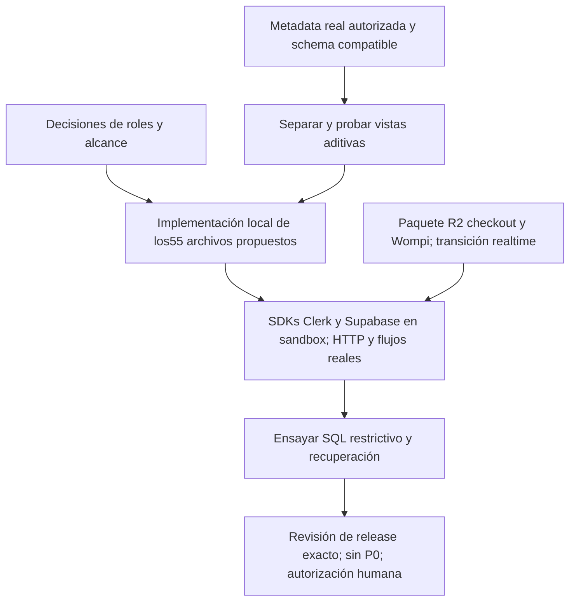

# LG-R1 / LG-R1B — Preparación de seguridad y reproducibilidad

> **Actualización posterior — optimización local, 2026-10-15:** el propietario autorizó trabajar directamente en el repositorio local para preparar el lanzamiento, sin crear más sandboxes. Los cambios de seguridad y las mejoras de navegación, imágenes, cantidades y checkout ya se incorporaron al proyecto original. Las afirmaciones de preservación y aislamiento de este informe describen su ejecución histórica; no describen el árbol local actual. No se realizó despliegue ni operación monetaria. Consulte el estado actual y los comandos en [README](../README.md).

**LG-R1C, 2026-10-15 — estado vigente:**55 archivos aplicados en clon independiente; corrección de contexto revisada dentro de2 archivos; instalación/types/no-regresión PASS, runtime BLOCKED y producción NO-GO. El propietario confirmó tiers.manage para ADMIN y SUPER_ADMIN. Ver [informe de implementación](LG_R1C_LOCAL_SECURITY_IMPLEMENTATION_AND_INTEGRATION_VERIFICATION.md) y§21. Las secciones anteriores conservan la historia LG-R1/LG-R1B.

Fecha: **2026-10-15, America/Bogota**. Baseline: **49add73ae90b837c36553a0f2b535267c9610143**. Estado actual: **LG-R1B: preparación aislada terminada; propuestas sin aplicar; calidad/runtime PARTIAL**. LG-R1 se detuvo históricamente en Stage1; la directiva LG-R1B autorizó reanudar sólo la preparación. Las secciones1–11 son históricas; resultados vigentes en§§12–20. Dictamen comercial: **NO-GO vigente**.

Autoridad: directiva LG-R1 adjunta en esta conversación y [auditoría canónica](LA_GAVIOTA_PRODUCTION_READINESS_AUDIT_AND_ROADMAP.md). Este es un registro enfocado de preparación, no una segunda auditoría completa ni una implementación.

## 1. Decisión inmediata y motivo de parada

La inspección de metadatos de despliegue con sesiones existentes relacionó el **alias actual de producción** con un despliegue Vercel que GitHub vincula al **mismo commit auditado**. Antes de esta fase esa correspondencia estaba sin verificar. El commit contiene los defectos críticos de autorización documentados en LG-AUDIT-001/003.

Se activa la instrucción expresa de Stage 1:

> If evidence suggests an immediately exposed critical security weakness, stop and produce a clearly scoped incident-risk escalation for the authorized owner.

Se detuvo la preparación, se interrumpieron los tres frentes y se permitió únicamente preservar evidencia, cerrar procesos propios y documentar la escalación. No se ejecutaron nuevas consultas remotas ni pruebas de exposición después de la orden de parada.

**Esto es una escalación por exposición potencial crítica, no una declaración de incidente consumado.** No se probó dispatch HTTP de las acciones privilegiadas, escalamiento real, acceso a datos de clientes ni pérdida financiera. No se autoriza cerrar la tienda ni aplicar contención o cambios de producción.

## 2. Evidencia de correspondencia de despliegue

| Eslabón | Evidencia observada | Alcance |
| --- | --- | --- |
| Alias vigente | vercel inspect https://www.lagaviotafruver.com --json, exit 0, con sesión existente; alias www y dominio raíz listados. | Resuelve el alias al momento de la consulta. |
| Despliegue | dpl_7akmDyb1H4VCuuzFBhjqCsoHqkv1, target production, readyState READY. | Estado del proveedor, no prueba de seguridad. |
| Relación con Git | GitHub combined status para SHA 49add73…: contexto Vercel, success, target_url termina en el mismo ID 7akmDyb1H4VCuuzFBhjqCsoHqkv1. | Vincula despliegue y commit por metadatos del proveedor. |
| Evidencia corroborante | GitHub Production deployment 5279006077, ref/sha 49add73…, creado 2026-07-02T04:06:58Z; main remoto mismo SHA. | La fecha del despliegue no es la fecha de observación. |
| Runtime declarado | Build Vercel READY, framework nextjs, nodeVersion 24.x. | No revela el patch exacto de Node ni el grafo instalado. |

La cadena **alias actual → despliegue → commit** queda **CONFIRMADA POR METADATOS**. No equivale a una atestación byte a byte del artefacto desplegado, de las variables de entorno ni de las dependencias resueltas durante aquella construcción. Tampoco prueba que cada export de una acción sea invocable por un atacante.

Evidencia durable:

- [Cadena de paridad y límites](lg-r1-evidence/2026-10-15/parity-incident-risk-evidence.json).
- [Comandos y respuestas resumidas](lg-r1-evidence/2026-10-15/remote-deployment-summary.json).
- [Procedencia del estado GitHub](lg-r1-evidence/2026-10-15/github-status-provenance-and-stop.json).

El timestamp exacto de las llamadas del conector GitHub no se capturó; no se inventa. El archivo de evidencia de paridad fue escrito a las 12:40:09.815259Z del 15 de octubre de 2026; es un momento de escritura local, no un timestamp certificado de respuesta. La salida completa de inspección Vercel permanece en el stage privado, fuera del repositorio; sólo se publican campos seleccionados.

## 3. Riesgo confirmado frente a exposición no verificada

| Área | Confirmado | No verificado | Acción de revisión del responsable |
| --- | --- | --- | --- |
| Identidad privilegiada | src/actions/users.ts:41–53 llama actualización de metadata Clerk sin guard de autenticación/rol; la auditoría previa lo reprodujo con mocks. | Invocación efectiva del endpoint/action ID en producción; abuso o cuentas afectadas. | Revisar exposición y priorizar borrador de guard con pruebas negativas antes de cualquier cambio. |
| Acciones administrativas | Órdenes, productos, precios y clientes tienen guards ausentes/incompletos en el commit vinculado. | Capacidad efectiva según registro de acciones y configuración desplegada. | Inventario completo de superficies callable y permisos efectivos, sin experimento en vivo. |
| Datos y storage | SQL versionado contiene permisos/políticas amplias. | Políticas/grants/schema exposure realmente desplegados. | Exportación autorizada de metadata únicamente; no solicitar filas de clientes. |
| Dependencias | Manifest/lock actuales desalineados; dry-run aislado EUSAGE. | Grafo exacto instalado en producción y aplicabilidad completa de advisories. | Recuperar metadata de build/SBOM y resolver baseline en copia desechable tras reanudación. |
| Integridad financiera | Defectos del baseline descritos en la auditoría continúan abiertos. | Transacciones afectadas o explotación histórica. | Fase posterior de checkout/Wompi; LG-R1 no autoriza refactor financiero. |

La investigación de incidente requeriría alcance propio, acceso autorizado a registros mínimos y un plan de preservación. No se infiere compromiso ni se recomienda rotación indiscriminada de claves sin evidencia o autorización.

## 4. Ejecución realizada y trabajo detenido

| Stage | Resultado de esta ejecución |
| --- | --- |
|1 Baseline y triage | HEAD local/remoto y alias vinculados; riesgo escalado. Sin pruebas de autorización en vivo. |
|2 Entorno aislado | Stage privado creado; no se crearon cuentas Clerk, proyectos Supabase ni servicios externos. PostgreSQL no llegó a iniciarse. |
|3 Contrato de autorización | Inventario y alternativas preliminares; matriz siguiente es propuesta para revisión, no contrato aprobado ni helper implementado. |
|4 Reproducibilidad | Dry-run con env limitado y configs npm vacías separadas: EUSAGE/exit1 por drift. Lectura de metadata de diez paquetes. Sin instalación limpia ni lock candidato. |
|5 Parches propuestos | **No se produjeron diffs de aplicación o políticas** antes de STOP. Ningún parche aplicado. No se presenta una propuesta exploratoria como migration-ready. |
|6 Aceptación | **No satisfecha**. Cero pruebas nuevas LG-R1 de autorización, DB o storage; pruebas previstas pendientes. |

Herramientas observadas: Node 24.13.0, npm 11.6.2, Vercel CLI 53.2.0 y gh 2.100.0. El build productivo declara Node 24.x. Las fuentes/locks del proyecto no fueron cambiados.

El primer dry-run falló por configuración del harness: usar /dev/null simultáneamente como user/global npmrc. Se corrigió usando dos archivos vacíos distintos; ese error no se atribuye a la aplicación. El segundo intento sí registró **npm error code EUSAGE**, con 151 observaciones Missing en el diagnóstico. Ese número no representa151 defectos independientes ni sustituye el conteo de seis dependencias directas ausentes.

No se repitieron lint/typecheck en LG-R1. Sus resultados anteriores siguen siendo evidencia histórica del entorno compartido: ESLint: 86 errores y 60 warnings; TypeScript bloqueado por prisma/config ausente en el Prisma compartido. No son resultados de una instalación limpia nueva.

## 5. Matriz preliminar de roles y capacidades

El código actual mezcla roles USER/OPERARIO/ADMIN/SUPER_ADMIN ofrecidos por UserManagementClient, COMMERCIAL/CLIENT en useRBAC, admin en minúsculas en middleware y tiers Personas Naturales/Micromercados/Restaurantes. Un tier comercial no debe conceder administración por sí solo.

La propuesta separa identidad, rol de personal y tier comercial, conserva Clerk y portales existentes y requiere decisiones del propietario para OPERARIO y COMMERCIAL.

| Actor sintético propuesto | Catálogo público seguro | Lectura de pedidos/perfil propios | Modificar catálogo/precios/inventario/pedidos ajenos | Gestionar identidades/roles |
| --- | --- | --- | --- | --- |
| Visitante |Sí, sólo proyección pública|No|No|No|
| Retail / Personas Naturales |Sí|Sí, ownership obligatorio|No|No|
| Micromercado |Sí; precio de tier sólo bajo contrato autenticado|Sí, ownership obligatorio|No|No|
| Restaurante |Sí; precio de tier sólo bajo contrato autenticado|Sí, ownership obligatorio|No|No|
| ADMIN |Sí|Según capacidades explícitas, no por parámetro libre|Propuesto para áreas aprobadas; pruebas positivas necesarias|Permiso exacto por decidir; sin escalamiento implícito a SUPER_ADMIN|
| SUPER_ADMIN |Sí|Según capacidades explícitas|Según contrato aprobado|Gestión propuesta con reglas de autoescalamiento/último superadmin por decidir|
| OPERARIO / COMMERCIAL |Catálogo público|Sin permisos privados deducidos por etiqueta|**PENDIENTE** de funciones reales aprobadas|No por defecto|
| Rol desconocido/metadata inválida |Sólo superficie pública|No|No|No|

Para aceptar cada acción: autenticar actor del servidor; obtener autoridad de rol vigente; validar capacidad y ownership antes de operar sobre el target; rechazar campos/roles no admitidos; registrar rechazo sin PII innecesaria. La configuración de claims y el comportamiento ante revocación/sesión obsoleta deben probarse.

No quedó decidido un modelo de sincronización Clerk↔Supabase. Se exploraron JWT de terceros con sub de texto y límites server-side; una tabla de autorización espejo o broker adicional **no está validado ni aprobado**. Antes de proponer SQL hay que fijar una autoridad única, sincronización/revocación y soporte real del gateway. auth.uid de UUID no debe asumirse compatible con IDs Clerk user_.

## 6. Cambios candidatos, aún sin diffs

Los siguientes son destinos concretos para preparar propuestas al reanudar; no constituyen autorización de edición ni un manifiesto cerrado de implementación.

| Ruta candidata | Efecto buscado | Dependencias / precaución |
| --- | --- | --- |
| src/lib/authorization.ts, nuevo propuesto |Contrato central deny-by-default de roles/capacidades y actor autorizado.|Autoridad de metadata y matriz aprobadas; imports server-only y versión Clerk comprobados.|
| src/actions/users.ts |Proteger listado y mutación de roles/tier; validar target y roles permitidos.|Decidir alcance ADMIN/SUPER_ADMIN y último administrador.|
| src/actions/businessApplications.ts; src/actions/customers.ts |Separar aprobación de tier, acceso administrativo y lectura propia.|No bloquear el flujo legítimo de solicitud del cliente.|
| src/actions/products.ts |Guards por capacidad en stock/precios/CRUD; separar DTO público de datos comerciales.|Product actual incluye baseCost y todos los tiers; revisar consumidores antes de cambiar forma.|
| src/actions/orders.ts |Guards/ownership de acciones expuestas y lectura propia.|No bloquear el escritor interno de checkout ni cambiar transacciones financieras en esta fase.|
| src/actions/settings.ts; src/actions/systemSettings.ts |Capacidad explícita para mutaciones; acceso público sólo a settings seguros.|Settings leídos por catálogo/checkout deben seguir funcionando.|
| src/actions/analytics.ts; src/actions/dashboard.ts; src/actions/audit.ts |Proteger lecturas sensibles y mutaciones administrativas.|Inventario final de exports pendiente.|
| src/actions/kits.ts; src/actions/suppliers.ts; src/actions/b2b.ts |Capacidades y ownership coherentes.|Permisos reales de personal/tier por acordar; sin refactor de cobros.|
| app/api/marketing/abandoned-cart/trigger/route.ts; app/api/marketing/loyalty/reorder/route.ts |Autenticación del scheduler antes de consultar/mutar DB.|Missing/wrong secret falla cerrado; no activar notificaciones comentadas.|
| app/api/marketing/abandoned-cart/sync/route.ts; app/api/marketing/lead-capture/route.ts |Revisar actor, validación, límites y contrato público.|No convertir captación pública legítima en endpoint sólo admin.|
| src/lib/supabase.ts y clientes inline / ProductForm |Adaptar identidad y límites público/cliente/admin al modelo de políticas elegido.|Browser anon actual no transmite autoridad Clerk; endurecer RLS primero rompería flujos.|
| package.json; package-lock.json; .env.example; configuración de checks |Baseline reproducible, scripts de tests aislados y documentación real.|Sólo tras revisión; no instalar contra servicios reales ni regenerar lock ciegamente.|
| Futuro archivo de migración bajo supabase/migrations/ |Políticas/grants mínimos y proyección pública de columnas.|Nombre y SQL aún no preparados; metadata real y cliente migrado primero; no aplicar producción.|

Posible separación de escritor interno server-only se evaluaría para evitar que proteger un export rompa checkout. Todavía no existe propuesta ejecutable ni evidencia de regresión. Archivo exacto y cambios de imports se fijarán con el diff antes de pedir aprobación de implementación.

## 7. Identidad, datos y storage: orden y rollback requeridos

1. Obtener metadata autorizada de políticas/grants/schema y contrato real de JWT/roles, sin filas de clientes.
2. Definir una única autoridad de rol y su revocación; distinguir tier de capacidad administrativa.
3. Preparar clientes públicos seguros, cliente autenticado por actor y frontera administrativa server-only. Nunca exponer service-role en browser.
4. Probar tablas y storage con roles efectivos en PostgreSQL desechable y luego gateway de prueba real; una fixture de auth.jwt o storage.objects no certifica firmas Clerk, PostgREST o Storage API.
5. Preparar diff SQL y transición coordinada cliente/políticas con rollback ensayado. No usar USING(true) ni restaurar permisos amplios como rollback automático.

Cambios de roles/grants y eliminación de políticas son sensibles a dependencias de UI, jobs y webhooks. La migración debe prevalidar schema/columnas y disponer de evidencia de recuperación; la futura fase financiera requerirá su propia autorización. No hay SQL aprobado ni ejecutado en esta entrega.

## 8. Plan de reconciliación de dependencias

Resultado nuevo: se confirmó con un dry-run online limitado al registro npm que el lock actual no permite npm ci. La copia candidate-install contiene sólo manifest y lock originales; no hay node_modules ni candidato resuelto.

Metadata del registro revisada antes de STOP: Next 16.2.1 requiere Node>=20.9.0; Prisma/client 7.8.0 declara ^20.19 || ^22.12 || >=24.0. Node local24.13.0 satisface esas declaraciones. Esto no demuestra una instalación compatible completa, funcionamiento de código ni ausencia de vulnerabilidades.

Al reanudar:

- Recuperar, si existe, lock y metadata del build desplegado; separar reconstrucción del baseline de actualización correctiva.
- Resolver las seis dependencias directas faltantes en copia privada con versiones explícitas revisadas, configuración npm vacía, env limitado y scripts desactivados inicialmente.
- Ejecutar npm ci desde cero sobre el candidato, verificar integridades y peers sin --force ni --legacy-peer-deps para esconder incompatibilidades.
- Triage de advisories contra el grafo real y funciones usadas; no adoptar automáticamente un downgrade sugerido por npm audit fix. No se eligió versión correctiva en esta ejecución.
- Ejecutar lint/types/build sólo con el nuevo entorno y servicios sintéticos aislados. No ejecutar scripts legacy de órdenes ni generación estática contra DB real.

Las alertas de la auditoría anterior son históricas; su triage completo no terminó antes de la parada. No se afirma que actualizar a una versión consultada resuelva todo el riesgo.

## 9. Matriz de pruebas requerida y estado real

| Grupo | Evidencia requerida al reanudar | Estado LG-R1 actual |
| --- | --- | --- |
| Acción de roles |Guest/retail/B2B no llaman mutación privilegiada; admin autorizado positivo; target/rol inválido rechazado.|**NO EJECUTADO**; no helper ni overlay escritos.|
| Administración directa |Invocar funciones propuestas reales con actores sintéticos; denegación antes de operación; rutas legítimas positivas.|**NO EJECUTADO**; no confundir con prueba HTTP.|
| Ownership |Cliente ve/modifica sólo recursos permitidos propios; otro owner denegado; admin según capacidad.|**NO EJECUTADO**.|
| API scheduler |Secret ausente/incorrecto impide toda consulta/escritura; autorizado idempotente.|**NO EJECUTADO**; sin POST en producción.|
| PostgreSQL RLS/grants |Roles efectivos guest/retail/B2B/admin/superadmin; deny/allow por tabla/columna; claims desconocidos no elevan.|**NO EJECUTADO**; PostgreSQL nunca se inició.|
| Storage |Lectura pública sólo media aprobada; sin upload/update/delete anon; upsert administrativo con permisos necesarios.|**NO EJECUTADO**; gateway real de prueba no provisionado.|
| Catálogo y workflows |Proyección pública sin costos/datos privados; historial propio y portales conservados; checkout interno no roto por guards.|**NO EJECUTADO**; contrato público pendiente.|
| Aislamiento |Env sin credenciales reales; imports/egress restringidos; scripts rechazan destino/secret no sintético; DB Unix-only con sentinel.|Stage creado; harness/DB aún no implementados ni aceptados.|
| Instalación baseline |npm ci --dry-run en copia aislada.|**FAIL EUSAGE**, exit1, no instalación realizada.|
| Lock candidato/clean install |Nuevo lock revisado y npm ci repetible con versiones/integridades documentadas.|**NO EJECUTADO**.|
| Lint/types |Baseline anterior separado de candidato; captura de exit codes reales.|Sólo histórico; sin rerun LG-R1.|
| Metadatos de despliegue |Cadena vigente alias/deployment/commit.|**CONFIRMADA POR METADATOS**; artefacto/env/grafo instalado no atestados.|
| HTTP/browser autenticado |Servidor aislado con usuarios ficticios; dispatch/action/API y retorno a portal.|**NO EJECUTADO**; no cuentas ni app servidor iniciados.|

Las cinco reproducciones mock de la auditoría previa no se suman como pruebas nuevas LG-R1 ni demuestran que las correcciones existan. No hay pruebas de aceptación de seguridad nuevas PASS en este paquete detenido.

## 10. Registro de riesgos y decisiones pendientes

| ID | Riesgo / decisión | Estado y responsable propuesto |
| --- | --- | --- |
|R1-R01|Código con fallas críticas vinculado por metadata al alias productivo.|**Escalación urgente** al propietario; accesibilidad/abuso no establecidos.|
|R1-R02|Continuar preparación tras la condición STOP sin revisión humana.|Bloqueado; requiere decisión explícita del propietario.|
|R1-R03|Políticas reales no conocidas; endurecimiento puede romper clientes anon.|Pendiente metadata mínima + diseño de transición, Security/DB Architect.|
|R1-R04|Roles OPERARIO/COMMERCIAL/ADMIN y tiers mezclados.|Matriz de negocio pendiente; no inventar capacidades, propietario.|
|R1-R05|Nueva autoridad espejo/broker puede divergir de Clerk.|Alternativas exploratorias; resolver autoridad/revocación antes de SQL.|
|R1-R06|Lock inválido y entorno de build no reproducido.|Release Engineering; no versión correctiva elegida ni clean-install logrado.|
|R1-R07|Mocks o fixture SQL usados para declarar seguridad productiva.|Prohibido; QA separa capa real, simulada, no probada y metadata.|
|R1-R08|Ajustes de autorización rompen escritura interna de checkout/webhook.|Diseño/contrato pendiente; fuera de refactor financiero y con regresión aislada obligatoria.|
|R1-R09|Contención o rollback reactivo degrada disponibilidad o reabre permisos.|Cualquier producción requiere orden separada, alcance y rollback fail-closed revisados.|

## 11. Preservación, cierre y próxima autorización

Los agentes confirmaron cero procesos propios pendientes. No se iniciaron PostgreSQL, app server, Clerk ni Supabase. El frente DB conserva sólo sentinel sintético y carpetas vacías. Las sesiones de metadata y npm terminaron; no se necesitó matar procesos. No se tocaron servicios compartidos.

No se modificaron código de aplicación, package/lock, configuración, SQL/políticas, datos, cuentas, credenciales ni despliegues. No se ejecutaron transacciones, llamadas de pago, pruebas de privilegios ni acceso a clientes en producción; no hubo commit/push/merge/deploy.

Se actualiza únicamente la documentación y se añade evidencia sanitizada. La sección 26 de la auditoría canónica registra este nuevo estado sin reescribir la evidencia histórica. Su manifest de auditoría anterior conserva el hash de aquella revisión previa; la revisión LG-R1 queda vinculada por un manifest nuevo.

[Manifest LG-R1](lg-r1-evidence/2026-10-15/evidence-manifest.json), [preservación](lg-r1-evidence/2026-10-15/source-preservation.json), [cierre de procesos y resultados](lg-r1-evidence/2026-10-15/cleanup-stop-summary.json). Stage privado: /home/sebastiangarcia/.local/share/la-gaviota/lg-r1-20261015/. Contabilidad exacta de tokens/tier/costo y endpoints Mission Control siguen no disponibles; no se fabrican.

**Autorización siguiente requerida:** tras revisar esta escalación, autorizar expresamente **reanudar sólo la preparación y verificación aislada de LG-R1**, para completar matriz, diffs de aplicación/políticas y pruebas sintéticas, conservando las prohibiciones de producción y aplicación de fixes. Esa reanudación no autoriza implementar los parches en el repositorio.

Si el propietario desea contención o investigación de incidente en producción, debe dar una orden independiente con superficies permitidas, acceso de sólo lectura o cambios concretos, responsable y rollback. No se solicita permiso general para modificar producción. Una vez completados y revisados los diffs de LG-R1 habrá otro gate de aprobación de implementación.

## 12. LG-R1B — reanudación autorizada y resultado de preparación

Fecha: **2026-10-15, America/Bogota**. **Preparación y verificación aislada terminadas; propuestas sin aplicar; producción NO-GO.** La directiva LG-R1B revisó y aceptó la escalación conocida de LG-R1 y autorizó continuar exclusivamente en copias privadas. Las secciones1–11 conservan el registro histórico de la parada; esta sección y las siguientes describen el resultado posterior, sin convertir aquella parada en una implementación.

No hubo consultas nuevas a Vercel/GitHub/Supabase de producción ni pruebas para demostrar explotabilidad. Se reutilizó la asociación alias/despliegue/commit ya documentada. No apareció evidencia nueva de compromiso real; eso no equivale a una investigación de incidente ni a una conclusión de ausencia de abuso. La decisión defensiva de producción corresponde al responsable autorizado mediante un alcance independiente.

Stage privado: `/home/sebastiangarcia/.local/share/la-gaviota/lg-r1b-20261015/`, con separación de autorización, DB, dependencias y QA. PostgreSQL usó socket Unix privado sin TCP; SDKs en pruebas de acciones fueron mocks; npm usó registro público con env mínimo, configs privadas y scripts deshabilitados. No se cargaron `.env` de aplicación, claves reales ni datos de clientes. Las verificaciones de aislamiento son acotadas: instrumentación Node/Python y guardas de destino no certifican cada syscall del host.

| Stage | Resultado de LG-R1B | Límite |
| --- | --- | --- |
|A Baseline|PASS: mismo HEAD;398 archivos preservados antes de escribir documentación.|Al cierre396 permanecen idénticos y sólo los dos informes autorizados cambian.|
|B Contrato|PASS como propuesta: identidad/rol/tier/capacidad/owner separados; matriz completa.|Decisiones del propietario pendientes; no permisos reales modificados.|
|C Aplicación|PASS de preparación: patch revisable, inventario y pruebas del source candidato.|Sin Next dispatch, servidor autenticado ni SDK real.|
|D Datos/storage|PASS del modelo SQL:315/315 casos; transición BLOCKED.|Schema parcial sintético; gateway/claims firmados/Storage API reales no probados.|
|E Reproducibilidad|PASS clean install y tipos; PARTIAL de calidad/seguridad.|Lint FAIL, advisories residuales, build/runtime no ejecutados.|
|F Aceptación aislada|Pruebas ejecutables y revisión independiente registradas; alcance runtime PARTIAL.|Ningún resultado acredita corrección de producción.|

Autoridades de entrega: [manifest LG-R1B](lg-r1b-evidence/2026-10-15/evidence-manifest.json), [verificación independiente root](lg-r1b-evidence/2026-10-15/root-verification.json), [preservación](lg-r1b-evidence/2026-10-15/source-preservation.json) y [QA independiente](lg-r1b-evidence/2026-10-15/qa/independent-summary.json). Los manifests históricos conservan los hashes de sus revisiones anteriores de estos informes.

## 13. Contrato propuesto de autorización y ownership

Se conserva Clerk como autoridad única. `getActor()` deriva el ID de `auth()`, consulta nuevamente el usuario con el SDK servidor y rechaza usuario ausente, ID inconsistente, banned/locked o fallo de lookup. Evalúa `publicMetadata` fresca; los claims de sesión antiguos no conceden privilegios. Los objetos Actor son emitidos internamente e inmutables. `requireCapability`, `requireOwnedSubject`, `assertTargetId`, `validateRole` y `validateTier` centralizan la frontera antes de acceder al target. La consulta de identidad propia es necesaria para autorizar; cero dependencias privilegiadas significa cero operaciones sobre targets/datos de negocio antes de superar el guard, no cero consultas a Clerk.

`role` y `tier` son distintos. USER/CLIENT exactos o registro nuevo sin metadata producen cliente; Micromercados/Restaurantes sólo seleccionan el precio autorizado. `role=admin`, un tier administrativo o metadata desconocida no elevan. Un rol inválido sólo obtiene catálogo retail seguro. OPERARIO/COMMERCIAL mantienen capacidades propias de cliente, sin permisos de bodega/ventas inventados. Su alcance laboral y la migración de operadores legacy requieren decisión del propietario.

| Capacidad propuesta | Guest | Retail / Micro / Restaurante | ADMIN | SUPER_ADMIN | OPERARIO / COMMERCIAL | Rol inválido |
| --- | --- | --- | --- | --- | --- | --- |
|Catálogo público seguro|Sí|Sí, precio del tier vigente|Sí|Sí|Sí|Sólo retail|
|Perfil, historial y checkout propios|No|OWN|OWN|OWN|OWN|No|
|Productos, precios, inventario|No|No|Sí|Sí|No|No|
|Clientes, pedidos, pagos administrativos|No|No|Sí|Sí|No|No|
|Aprobar tier, reportes, settings, proveedores|No|No|Sí|Sí|No|No|
|Storage upload/update/delete|No|No|Sí|Sí|No|No|
|Enumerar identidades / cambiar rol|No|No|No|Sí|No|No|
|Leer audit log|No|No|No|Sí|No|No|
|Scheduler|No por rol humano|No por rol humano|No por rol humano|No por rol humano|No|No|

OWN exige igualdad de sujeto autenticado/propietario. Acceso administrativo a otro propietario exige capacidad explícita y consulta acotada; un target recibido no establece autoridad. Scheduler usa secreto independiente y comparación constante antes de DB, nunca rol del cliente. Se bloquean cambio de rol propio y degradación de SUPER_ADMIN a otro rol; sus workflows especiales no se inventan. La matriz asigna ADMIN a `tiers.manage` pero reserva identidad/roles a SUPER_ADMIN: necesita aprobación de negocio antes de implementación.

La [matriz completa por capacidad y actor](lg-r1b-evidence/2026-10-15/authorization/role-capability-ownership-matrix.json) y su [tabla legible](lg-r1b-evidence/2026-10-15/authorization/ROLE_MATRIX_ES.md) son el contrato detallado. No se ha cambiado ningún usuario ni permiso Clerk.

## 14. Parches de aplicación preparados y cobertura de callables

[Patch de autorización](lg-r1b-evidence/2026-10-15/authorization/application-security-proposal.patch): **53 archivos candidatos =47 existentes +6 nuevos**, SHA256 `910b8fce50bc87dfa269a22969e463c52563eadd7ceb0dd7b58b7db6e852c3d1`. [Manifest por archivo](lg-r1b-evidence/2026-10-15/authorization/proposal-files.json) y [lista de rutas](lg-r1b-evidence/2026-10-15/authorization/EXACT_PROPOSED_FILES_ES.md). Los dos archivos de dependencias se entregan en un patch separado; no están incluidos en esos53.

El [inventario completo con contrato, guard, owner, disposición y pruebas](lg-r1b-evidence/2026-10-15/authorization/callable-coverage-final.json) cubre **59 callables del baseline** y **62 del candidato**, incluidos5 handlers API. No implica que todos sean corregidos: Wompi webhook conserva el contrato provider/internal con P0 diferido. `createOrder` sale del módulo callable `'use server'` y pasa a `src/lib/server/orderWriter.ts`; cuatro exports de aplicación se añaden, incluidos media y catálogo administrativo. Los RSC y sinks internos adicionales están inventariados como fronteras, sin contarlos otra vez como endpoints.

La propuesta prepara guards para identidad/tiers, clientes, catálogo/precios/stock, pedidos/pagos administrativos, reportes/audit, settings, kits/proveedores y jobs. Vincula atribución administrativa al actor autorizado. Agrega `src/lib/server/{authorization,database,orderWriter,scheduler}.ts`, `src/actions/media.ts` y `src/lib/cartPersistence.ts`. Los writers server-only no tienen fallback a anon. **service_role omite RLS**: sus restricciones dependen del guard y del filtro/proyección en cada callsite; no se atribuye aislamiento de actores a la clave privilegiada.

El DTO público exporta únicamente el precio vigente autorizado y anterior de ese mismo tier; elimina baseCost y precios de otras audiencias. Se revisaron consumidores, proyección B2B anidada, historial own y escritura de audit. Los cambios de tarjetas/carrito/checkout son adaptaciones de datos, sin selector de cantidades ni rediseño UX. La persistencia existente se limita y reconcilia con IDs/cantidades y catálogo vigente; se prueban corrupción, datos legacy, precio ausente y fallo de carga. No existe todavía cotización autoritativa, sincronización runtime de auth/tabs ni contrato de aceptación de cambio de precio: siguen en su fase.

Media usa acciones servidor con `storage.manage`, destinos fijos, nombres generados, límite2MiB y firma/MIME coherentes; la propuesta eleva el límite multipart de Server Actions a3MiB. Reemplazar conserva el blob previo. La eliminación comprueba referencias en productos y kits y rechaza uso compartido/desconocido; esa comprobación no es atómica frente a remapeo concurrente. Su activación necesita una política aprobada de retención/purga. Esto no certifica decodificación hostil, Storage real, gestión integral de huérfanos ni restore. No se importó ni restauró fotografía alguna.

El escritor interno exige sujeto propio o administración explícita y se usa desde los dos inicializadores existentes. **Sigue haciendo writes separados y no valida integralmente cantidad/quote/idempotencia.** No se corrigieron atomicidad, Wompi signature/intent, replay, stock transaccional, abonos ni refund real. Esos P0 siguen abiertos y bloquean release.

## 15. Decisión Clerk/Supabase y SQL candidato

[ADR y transición detallada](lg-r1b-evidence/2026-10-15/database/ADR_TRANSICION_Y_RESULTADOS.md). No hay mirror de roles ni un nuevo proveedor/broker de identidad.

La ruta administrativa usa rol Clerk fresco y repositorio server-only. Las consultas propias actuales del candidato también usan ese servidor con filtro de owner: **RLS no protege esa consulta que usa service_role**. El diseño SQL admite futuras lecturas nativas autenticadas por Clerk Third-Party Auth soportado; `auth.jwt()->>'sub'` es TEXT, sin convertir `user_...` a UUID/auth.uid. Esa integración aún no fue configurada ni probada.

Un JWT native de usuario no obtiene DML directo por tener ADMIN/SUPER_ADMIN. SQL verifica ownership y grants de columnas; no confía en labels de rol para administración. La fixture SQL no valida firma/issuer/audience/exp ni revocación. Un token válido previamente emitido puede leer sus propias filas hasta vencer conforme al gateway. El caso con exp vencida que aún lee en el stub demuestra esa limitación, no un rechazo real de token. El servidor rechaza metadata inválida para métodos privados; la ruta SQL own acepta identidad válida aunque su rol de aplicación sea desconocido. La uniformidad de esa política y la revocación inmediata necesitan decisión explícita; no se ocultan con una tabla espejo.

Artefactos sin aplicar: [SQL](lg-r1b-evidence/2026-10-15/database/proposals/lg-r1b-policy-proposal.sql.txt), [patch SQL](lg-r1b-evidence/2026-10-15/database/proposals/lg-r1b-policy-proposal.patch), [solicitud metadata-only](lg-r1b-evidence/2026-10-15/database/metadata-request.sql.txt) y [rollback fail-closed propuesto](lg-r1b-evidence/2026-10-15/database/failclosed-rollback.sql.txt). SQL SHA256 `88eff4933862913457e11e92474d4cf9d83501b8f9afcacb340e238cfb164def`.

Se probaron17 tablas app y2 Storage en PostgreSQL18.6 real, derivando tipos escalares de Prisma, sin reproducir todas las migraciones/FK/triggers/defaults. Views `catalog_public`/`kits_public` activas y con proyección segura; se revocan ACL de tabla y columna sensibles, incluida una columna extra de fixture. Own SELECT en perfil/pedidos/detalles; sin DML directo de cliente. Storage distingue operación GET de listado y deniega mutaciones directas incluso con claims admin. `auth.jwt()` y helper Storage son stubs explícitos. El bypass de service_role se demuestra intencionalmente y no se cuenta como aislamiento RLS.

**Activación SQL BLOCKED.** El inventario identifica29 módulos cliente originales sin token Clerk nativo. Quedan el Kanban con realtime anon y el webhook Wompi anon: restringir permisos hoy rompería esas rutas; cambiar el callback a service_role sin corregir su frontera financiera sería inseguro. El SQL candidato es una transacción final conjunta, no una secuencia additive-first ya validada. Antes de implementar la transición hay que separar/revisar/ensayar una etapa aditiva de vistas y su compatibilidad, adaptar la aplicación y resolver R2/realtime, y sólo después ensayar revocaciones finales. No ejecutar ese SQL monolítico como primer paso.

También faltan metadata real de grants/ACL/default privileges/memberships/policies/RPC/views/functions/schema y helpers Storage, equivalencia audit_logs/orders y gateway sandbox. El review_gate y la lista de policy names desconocidos abortan en fixture; son preconditions, no una autorización automática. El alcance de19 tablas no descubre por sí solo funciones definer o vías externas existentes.

Rollback: mantener guards y proyecciones seguros; detener promoción ante acceso inesperado, catálogo/owner/precios erróneos, upload/callback/cron denegados o errores ocultados. Preferir roll-forward o restricción privada aprobada. **No volver al código vulnerable mientras service_role está habilitado ni restaurar grants públicos permisivos.** El SQL fail-closed de rollback es NOT EXECUTED, revoca lecturas privadas y no neutraliza service_role; un control/rotación del secreto tendría alcance independiente sobre sus consumidores. Ningún rollback financiero, borrado de media o restauración de datos está autorizado.

## 16. Dependencias: candidato reproducible, calidad pendiente

[Patch manifest/lock](lg-r1b-evidence/2026-10-15/reproducibility/dependency-reconciliation.patch) y [candidato exacto](lg-r1b-evidence/2026-10-15/reproducibility/candidate-final/package.json). Manifest SHA256 `7bcb5bf41cf599dffd487cb3c1032b1cb81350ace0e2f43bd009a0587b8e8c6b`; lock SHA256 `1906288202e7b4c44e61659787ea3f9577ea9b37f7404098dd5c89b1c56b7157`.

Se corrigió el drift de las seis dependencias directas ausentes y se fijaron26 directos, sin framework major change. Next/eslint-config-next16.4.1 y Clerk6.39.7 son correcciones candidatas revisadas; React runtime19.2.4/Prisma7.8 permanecen. Types React/DOM19.3 se alinean para resolver ERESOLVE estricto. Node24.13.0/npm11.6.2 son las versiones realmente usadas para instalación; no se actualizó el host. Nodepatch actual y soporte de ESLint9 EOL requieren revisión antes de release.

**npm ci desde cero PASS**:539 paquetes en tmpfs privado, scripts deshabilitados, strict engines/peers, sin force/legacy-peer-deps/overrides. Peer tree offline exit0.610 tarballs SHA512 y6 entries inBundle bajo integridad del padre;7 lifecycle scripts deshabilitados. Eso acredita instalación inicial, no generación Prisma ni ejecución de todos los paquetes.

El audit final informa12 entradas:0critical/9high/3moderate; con omitdev son7:4high/3moderate. Persisten cadenas ESLint y Prisma/config/dev/mysql2, incluidas transitivas opcionales que figuran en el grafo de producción. No se declaran todas dev-only ni se ejecutan downgrades sugeridos. El lock anterior era incompleto:15→12 no mide reducción de riesgo. [Triage y referencias](lg-r1b-evidence/2026-10-15/reproducibility/advisory-triage.json), [cambios clasificados](lg-r1b-evidence/2026-10-15/reproducibility/dependency-change-plan.json) y [handoff técnico](lg-r1b-evidence/2026-10-15/reproducibility/HANDOFF_STAGE_E.md).

## 17. Pruebas, revisión independiente y límites de aceptación

| Ejecución final / alcance | Resultado | Interpretación |
| --- | --- | --- |
|Funciones source candidato en VM|**535/535 PASS**|Mocks estrictos de Clerk/DB/storage; no Next HTTP ni SDK real.|
|PostgreSQL18.6 roles/RLS/ACL/Storage stub|**315/315 PASS**|Cluster real sintético;19 tablas antes/después idénticas; sin JWT/gateway/API real.|
|Instalación limpia final|PASS exit0|539 paquetes; scripts inicialmente deshabilitados.|
|TypeScript copia original con dependencias finales|PASS exit0|Resuelve bloqueo prisma/config histórico; no build.|
|TypeScript copia con propuesta de seguridad|PASS exit0|Compatibilidad estática de source+dependencias candidatos.|
|ESLint copia original131 archivos|FAIL:82 errores/58 warnings|Scope distinto del audit original; no comparación directa con143 archivos históricos.|
|ESLint scope propuesto53 archivos /47 originales comparables|FAIL:36 errores/28 warnings vs37/30|Cero mensajes nuevos con normalización relativa/regla/severidad/primera línea; no equivale a lint PASS.|
|Patch app y patch dependencias|PASS git apply --check|Read-only; ninguno aplicado al repo original.|
|Build, Next HTTP, login/portal/media reales|BLOCKED / NOT EXECUTED|Sin sandbox real con SDKs y fonts/static generation reemplazados.|
|Políticas desplegadas, autorización productiva|UNVERIFIED|Sin nuevas consultas remotas ni prueba de explotación.|

[Resultados de acciones](lg-r1b-evidence/2026-10-15/authorization/synthetic-results.json), [SQL](lg-r1b-evidence/2026-10-15/database/test-summary.json), [lint comparable](lg-r1b-evidence/2026-10-15/authorization/lint-comparison.json) y [evidencia QA](lg-r1b-evidence/2026-10-15/qa/independent-summary.json). QA independiente reprodujo535/535 y ejecutó12/12 comprobaciones propias con Node24.13.0; el autor usó Node24.21.0. Se observaron cero intentos de red en la instrumentación de QA y cero errores/warnings de lint en los seis módulos nuevos. Una comprobación de baseline/harness forma parte de las535; no son535 aceptaciones comerciales. QA verifica la propuesta final y conserva sus propios resultados; sus replays y corridas intermedias no se suman otra vez como casos nuevos. No se declara un total único mezclando SQL, asserts mock y comandos.

Cobertura funcional: guest/retail/B2B/OPERARIO/COMMERCIAL/invalid/lowercase/tier-admin denegados antes del target; roles legítimos positivos; target inválido; own/cross-owner; rol degradado con claims SUPER_ADMIN antiguos; fallo de identidad; secretos scheduler; catálogo sin costos/otros tiers; media; writers internos y compatibilidad DTO/persistencia. La revisión detectó y corrigió en las propuestas nombres de vistas, previousPrice del tier, fallback de settings, audit eager, proyección anidada B2B, referencias media cruzadas, atribución del actor y aceptación de capacidades desconocidas. No cambió ninguna función original para conseguir esos resultados.

Incidente del entorno: duplicación de instalación/caché agotó el filesystem raíz (**ENOSPC**). Se pausaron los frentes y se retiraron sólo caché propia regenerable y node_modules duplicado incompleto, liberando1,637,240,832 bytes. No se borraron archivos ajenos. Se reconstruyó la evidencia truncada y la instalación final se trasladó a tmpfs con umbrales raíz512MiB/tmpfs4GiB/MemAvailable4GiB. Se preservan diagnóstico y resultados finales separados. No se certifica disponibilidad global del host durante el incidente; se verifican hashes de fuente y cierre de procesos propios. Las corridas SQL301/313 y VM anteriores son históricas y no se suman.

## 18. Transición y siguiente alcance exacto para aprobación



La siguiente autorización recomendada es **implementar localmente en rama/copia aislada los53 archivos del patch de seguridad y package.json/package-lock.json candidatos**, después de aceptar la matriz de roles y sin migraciones/deployment. Registrar hashes exactos y cambios de compatibilidad; resolver lint/advisories con alcance revisado, y crear pruebas/regresión reproducibles. No es aprobación para promover esos55 archivos juntos a producción. El patch de SQL continúa propuesta independiente y bloqueada, incluso si se aprueba el patch de aplicación.

Orden posterior: metadata-only autorizada; separar vistas aditivas y probar el contrato real; SDK/gateway/Storage/HTTP sandbox; cierre del callback y transacciones en R2 con autorización separada; resolver Kanban realtime; ensayo coordinado de restricciones y fail-closed recovery; CI/build/role/owned journey/restore/rollback; revisión de exact SHA para release. Rechazar cambios que hagan fallback público ante error, oculten unavailable como vacío o vuelvan a permisos amplios.

Decisiones abiertas: permisos laborales OPERARIO/COMMERCIAL; ADMIN frente a SUPER_ADMIN para identidades/tiers/audit; transición de lowercase admin y tiers legacy; propio perfil/checkout de personal; revocación en vuelo y nativeJWT hasta exp; política uniforme de rol inválido; publicar stock exacto; soporte/retención de leads; schema/policies/RPC reales; soporte Node/ESLint/advisories; setup sandbox. Cantidades/unidades/stock/entrega/kit/quote/abono/refund se resuelven en R2/UX, no por defaults de esta fase.

## 19. Handoff, reproducción y preservación final

El [archivo del harness y copias propuestas](lg-r1b-evidence/2026-10-15/authorization/source-harness.tar.gz), el [harness VM](lg-r1b-evidence/2026-10-15/authorization/run-synthetic.cjs), el [harness SQL](lg-r1b-evidence/2026-10-15/database/run-isolated.py) y el [wrapper de dependencias](lg-r1b-evidence/2026-10-15/reproducibility/reproduce-candidate.py) son artefactos de preparación, separados de rutas de aplicación. Los scripts conservan paths privados y requisitos del baseline auditado: no son ejecutables portátiles sin revisar/restaurar el stage y dependencias exactas. No contienen node_modules, PGDATA, `.env`, credenciales ni dumps de clientes. `replay-isolated.py` y el modo `--install` del wrapper nuevo no se ejecutaron; el harness SQL y el instalador final sí. No se lanza otro servicio al leer este informe.

Comandos de reproducción acotada en el stage preservado:

```sh
env -i PATH=/usr/bin:/bin LANG=C.UTF-8 /usr/bin/node /home/sebastiangarcia/.local/share/la-gaviota/lg-r1b-20261015/authorization/run-synthetic.cjs
env -i PATH=/home/sebastiangarcia/.nvm/versions/node/v24.13.0/bin:/usr/bin:/bin LANG=C.UTF-8 python3 /home/sebastiangarcia/.local/share/la-gaviota/lg-r1b-20261015/reproducibility/reproduce-candidate.py --check-only
```

La repetición SQL requiere un substage nuevo mediante wrapper revisado, nunca reutilizar/borrar el cluster preservado. No ejecutar el SQL en Supabase remoto ni adaptar las guardas para aceptar variables/credenciales reales. La evidencia primaria identifica comandos, entorno y versiones reales de cada ejecución.

Root vuelve a comprobar HEAD, manifests, resultados, filas, patches y hashes. De398 archivos previos, **396 permanecen idénticos y sólo los dos documentos canónicos autorizados cambian**. Cero archivos tracked distintos; package/lock, código/config/SQL originales conservados; sin node_modules creado en el paquete original. PostgreSQL propio queda detenido; no se inició Next ni se modificaron servicios compartidos deliberadamente. No hubo login/cambio de usuarios, datos/clientes privados, apuestas/pagos/pedidos reales, nuevas consultas de producción, commit/push/merge/deploy. No se reconstruyó Graphify porque no cambió código del workspace; los overlays son privados externos.

El registro local de tareas sustituye endpoints Mission Control/memoria remota no disponibles. Tokens exactos in/out, tier y costo no están expuestos y no se estiman. El trabajo termina aquí conforme al STOP de LG-R1B: **paquete preparado para revisión y autorización de implementación local; NO-GO comercial vigente**.


## 20. Gate final A–H para decisión del propietario

| Decisión | Respuesta de LG-R1B |
| --- | --- |
|A Seguridad|Los defectos fuente de autorización siguen confirmados en el baseline. Las correcciones propuestas superan pruebas sintéticas de guards/owners/roles; el código original permanece vulnerable según la auditoría. Explotabilidad, abuso y políticas efectivas de producción continúan sin verificar.|
|B Parches|Técnicamente revisables para implementación local posterior:53 archivos, hash congelado, dry-run, tipos y QA. Aprobación de matriz/aliases y pruebas SDK/HTTP/build reales siguen siendo condiciones; no listos para release.|
|C Transición DB|El modelo SQL es coherente y315 pruebas pasan, pero todavía no preserva todos los flujos legítimos bajo sus revocaciones: callback Wompi y Realtime anon pendientes. SQL productivo BLOCKED; separar/ensayar etapa aditiva, metadata y sandbox real antes del corte.|
|D Reproducibilidad|Sí para el candidato exacto: instalación limpia539 paquetes, peers estrictos e integridades; scripts inicialmente deshabilitados. No se afirma build ni runtime reproducidos.|
|E Pruebas|535/535 asserts VM del autor y replay independiente;315/315 SQL;12/12 comprobaciones propias QA. No sumar replays ni fronteras solapadas. Denegaciones antes del target y positivos de admin/owner, claims inválidos, grants/columnas/media y fallos documentados.|
|F Riesgos pendientes|Lint FAIL, advisories altos residuales, Nodepatch/ESLint soporte, metadata/gateway/Storage/runtime, roles de negocio, revocación y media concurrente/retención. Pedidos/pagos/stock/idempotencia siguen P0 R2.|
|G Próxima autorización|Sólo implementar localmente el patch de53 archivos y manifest/lock de2 archivos, con matriz aprobada, ensayos y rollback fail-closed. Metadata remota, SQL, sandbox externo, R2, contención y release necesitan scopes propios. Ninguna aplicación automática tras este informe.|
|H Preservación|HEAD sin cambios;398 archivos iniciales comparados,396 iguales y sólo dos documentos autorizados revisados; cero diferencias tracked. Sin modificaciones de aplicación/config/lock/SQL originales, cuentas/datos/políticas/despliegues productivos ni nuevas consultas de producción. PG propio detenido.|


## 21. LG-R1C — implementación local completada, no productiva

La directiva LG-R1C autorizó aplicar los55 archivos en un clon independiente. Ambos frozenpatches coincidieron y se aplicaron; una corrección limitada de middleware/helper fue revisada y aplicada posteriormente, sin cambiar capacidades. La respuesta expresa del propietario **conservó tiers.manage en ADMIN y SUPER_ADMIN**; esa decisión deja de estar pendiente. No se modificó una identidad real.

Resultados nuevos:535/535 casos contra source implementado y20/20 contexto, reproducidos independientemente; QA propia12/12 y5/5, sin agregarlos como propiedades distintas. Instalación nueva539 paquetes y TypeScript final PASS; cero diagnósticos lint nuevos, con36errores/28warnings heredados en scope y full lint FAIL.12 nodos advisory abiertos,9high. Next16.4.1 real se ejecutó bajo aislamiento del kernel; terminó bloqueado por Inter y loopback down. SDK/HTTP/JWT/Storage auténticos no se acreditan.

El original mantiene HEAD y366 archivos tracked idénticos; de492 archivos previos, sólo estos dos informes autorizados cambian. Se añade un informe de implementación y evidencia. SQL no aplicado, PG no iniciado, Wompi/Realtime y P0 financieros pendientes. Las315 pruebas SQL LG-R1B son históricas, no una nueva corrida LG-R1C. El antiguo tooltree tmpfs LG-R1B fue retirado de forma acotada para evitar duplicación; nuevos comandos y requisitos figuran en el informe LG-R1C.

[Informe vigente y gate A–I](LG_R1C_LOCAL_SECURITY_IMPLEMENTATION_AND_INTEGRATION_VERIFICATION.md), [manifest LG-R1C](lg-r1c-evidence/2026-10-15/evidence-manifest.json). Los hashes de documentos en manifests anteriores corresponden a sus revisiones históricas. Próxima decisión: integración runtime controlada y planificación separada LG-R2; no repetir aplicación local ya completada, no autorizar SQL/producción implícitamente. **NO-GO comercial vigente.**
